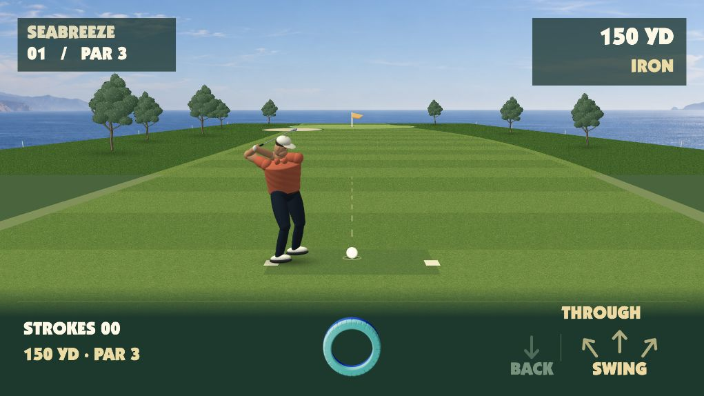

# Golden Tee — Board web prototype

A solo par-3 golf hole controlled with the physical Save the Bloogs ring. Built from the Board Studio starter with TypeScript, Vite, a Canvas 2D course, and an articulated 3D golfer.

Slide the ring back, then forward to swing. Speed sets power and the forward path sets direction. Play through the fairway, rough, bunker, green, and cup, then choose Rematch or Change setup.



## Play in a browser

```sh
npm ci
npm run dev
```

Open the local address Vite prints. The browser toolbar is a simulator and does not ship to Board.

1. Click **Place ring**, or Shift-click near the bottom centre.
2. Drag the visible ring toward yourself, then forward along the arrows.
3. Slide faster for more power. Angle the forward stroke to aim left or right.
4. After the ball rests, return the ring to the bottom centre and take the next shot.

The game chooses an iron, wedge, or putter for your lie. Fewer strokes wins. A result waits for Rematch or Change setup.

- Drag an existing simulated ring normally; hold Shift to place a new one.
- Press Backspace or click Lift ring to lift it.
- Press P or click Menu to pause. Enter resumes.
- How to play on the title demonstrates the controls.

The desktop simulator does not persist a round across page reloads. Real Board saves use the platform layer.

## Board package

```sh
npm test
npm run pack
board-connect install golden-tee.webapp.zip --launch
```

Use the Save the Bloogs ring (glyph 1). Keep hold of it while sliding; do not throw it.

- appId: `e087aaee-903b-43a2-b2b9-bbd4189601b2`
- packageId: `fun.board.dev.goldentee.e087aaee`
- SDK: vendored `1.0.0-beta.8`; keep its tarball and the lockfile.

The native system menu provides How to swing, Restart hole, and Change setup. The platform owns audio, saves, and exit.

## Design and evidence

See [the plan](docs/PLAN.md), [build checklist](docs/BUILD-CHECKLIST.md), and [acceptance ledger](docs/ACCEPTANCE-LEDGER.md).
The current build has 137 passing tests (3 catalog-only checks skipped), a complete browser playthrough, and a verified Board installation and title screen. Physical ring sensing, sustained native performance, and human swing feel still need a full device playtest.

Artwork, the Board SDK, font, platform layer, and piece-set assets have separate provenance and terms; see the [asset manifest](docs/ASSET-MANIFEST.md). Keep the vendored SDK and package lockfile so a fresh checkout uses the tested SDK version.
