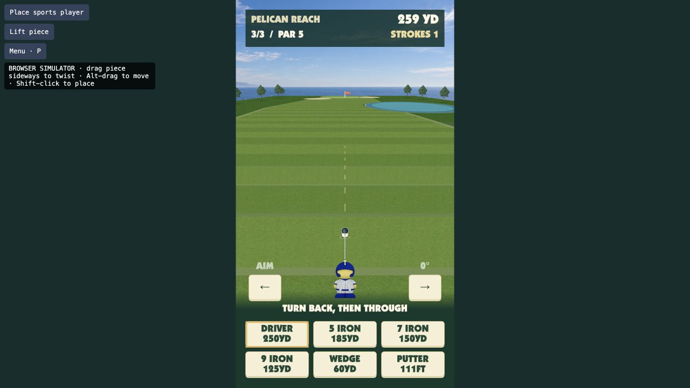

# Golden Tee — Board web prototype

A solo three-hole coastal golf round controlled with any physical Sports player. Play a 150-yard par 3, a 340-yard par 4, and a 510-yard par 5. Built from the Board Studio starter with TypeScript, Vite, and Canvas 2D. Play in portrait orientation from Board’s left short edge.

Place the piece on the open grass and hold it still to set your starting angle. Turn it back toward yourself, then return the club to the ball to hit. Backswing sets power. Select a driver, 5 iron, 7 iron, 9 iron, wedge, or putter, and use the arrows to aim. The club appears only with the piece, attached to its center front and sized to its footprint. The camera and resting ball stay fixed while you place or turn the piece; the camera follows the ball after a hit.



## Play in a browser

```sh
git clone https://github.com/Kevinmthau/board-goldentee.git
cd board-goldentee
npm ci
npm run dev
```

Open the local address Vite prints. The browser toolbar is a simulator and does not ship to Board.

1. Click **Place sports player**, or Shift-click on the open grass, then hold still briefly.
2. Drag sideways across the simulated player to bring the club back.
3. Grab it again and drag the other way until the club returns to the ball. A larger backswing gives more power.
4. Select a club and use the aim arrows before the next swing. A full 7 iron reaches the first green.
5. Choose **Next hole** after each of the first two holes. The last scorecard totals the round against par 12.

Water costs one penalty stroke and returns the ball to its previous lie. Carry it in the air or use a shorter club to lay up. Sand reduces carry and roll. Each hole has a ten-stroke limit.

At the next lie, hold the piece still to set your new starting angle before swinging again.
Lifting the piece removes the club and leaves the course clear, with no replacement character graphic.
The browser-only facing arrow shows the current direction; canonical piece art stays upright.

- Hold Alt while dragging to move the simulated piece.
- Press Backspace or click Lift piece to lift it.
- Press P or click Menu to pause. Enter resumes.
- How to play on the title explains the controls.

The desktop simulator does not persist a round across page reloads. Real Board saves use the platform layer.

## Board package

```sh
npm test
npm run pack
board-connect install golden-tee.webapp.zip --launch
```

Use any Sports player (glyphs 1–8). Keep hold of it while twisting. Native Board input and the framebuffer stay at 1920×1080; the game rotates its portrait scene toward the left short edge.

- appId: `e087aaee-903b-43a2-b2b9-bbd4189601b2`
- packageId: `fun.board.dev.goldentee.e087aaee`
- SDK: vendored `1.0.0-beta.8`; keep its tarball and the lockfile.

The native system menu provides How to swing, Restart round, and Change setup. The platform owns audio, saves, and exit.

## Design and evidence

See [the plan](docs/PLAN.md), [build checklist](docs/BUILD-CHECKLIST.md), and [acceptance ledger](docs/ACCEPTANCE-LEDGER.md).
The three-hole revision passed 208 automated checks, with three catalog-only checks skipped. Tests cover the full round, hazards, clubs, saves, and rematch. It retains the correctness fixes for slow returns, consistent shot timing, and pause/resume. Earlier browser evidence includes a two-stroke birdie after those fixes; current browser checks cover the new courses, water penalties, driver carry, scorecards, and rematch.

The three-hole package is installed and launched on KT's Board. Native rendering confirms all six club controls. The new holes and larger driver still require a physical playtest. Comfortable physical scale, all Sports shapes, native platform behavior, and sustained performance remain open.

Artwork, the Board SDK, font, platform layer, and piece-set assets have separate provenance and terms; see the [asset manifest](docs/ASSET-MANIFEST.md). Keep the vendored SDK and package lockfile so a fresh checkout uses the tested SDK version.
