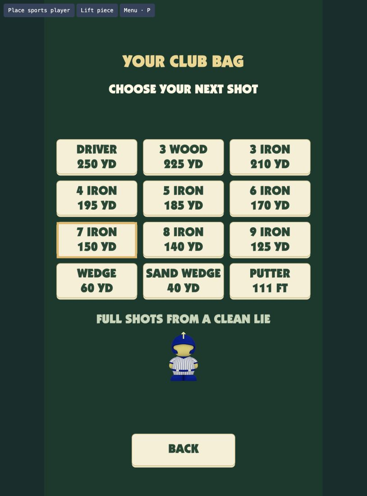

# Tee Time — Board web prototype

A one-to-four-player nine-hole coastal golf round controlled with any physical Sports player. Play 3,200 yards across nine holes totaling par 36, with steady wind and a traditional golf scorecard. Built from the Board Studio starter with TypeScript, Vite, and Canvas 2D. Play in portrait orientation from Board’s left short edge.

Place the piece in the circle on your name and hold it still briefly. The round starts automatically, and you can swing from that position. Turn it back toward yourself, then return the club to the ball to hit. Backswing sets power; a quarter turn (90 degrees) reaches 100%. Tap **Club bag** to select driver, 3 wood, 3 through 9 irons, wedge, sand wedge, or putter. The club appears only with the piece, attached to its center front and sized to its footprint. The camera and resting ball stay fixed while you place or turn the piece; the camera follows the ball after a hit.

Putting uses the original swing response again. Turn back at least 40 degrees, watch the power percentage, then return through the ball. A 90-degree turn gives full power, and aim arrows adjust by two degrees. The curved grid shows the green's undulations. Account for uphill, downhill, and sidehill break before returning the club to the ball.



The standalone project lives at `/Users/kevinthau/tee-time`, outside Board-tennis. Use this directory for development and packaging.

## Play in a browser

```sh
git clone https://github.com/Kevinmthau/board-goldentee.git tee-time
cd tee-time
npm ci
npm run dev
```

Open the local address Vite prints. The browser toolbar is a simulator and does not ship to Board.

1. Choose **Players** to add up to four people through the Board player selector. Place a Sports piece in the circle on the first player’s name to start. Solo players use the named circle on the title. A saved round names the next golfer and continues from the same circle.
2. Drag sideways across the simulated player to bring the club back.
3. Grab it again and drag the other way until the club returns to the ball. A larger backswing gives more power.
4. Select a club and use the aim arrows before the next swing. A full 7 iron reaches the first green.
5. After each multiplayer shot, the course stays visible and announces the next player’s turn. Place the Sports piece anywhere on Board and hold briefly, or keep the shared piece where it is. No turn circle or Ready tap is needed.
6. Each player keeps a separate ball and score. Choose **Next hole** after everyone finishes. Lowest total wins; ties share the win.

The shot view keeps only hole/par and distance at the top. Wind, player details, and Scorecard sit below the course. Aim and club controls disappear while the ball moves.

The wind arrow points where the wind blows, at the displayed mph. Wind affects airborne shots. Grounded rolls follow the green's slopes instead. Open **Scorecard** between shots or through the platform menu to see hole-by-hole yards, par, strokes, and totals.

Water costs one penalty stroke and returns the ball to its previous lie. Carry it in the air or use a shorter club to lay up. Sand reduces carry and roll. Each hole has a ten-stroke limit.

At the next lie, hold the piece still to set your new starting angle before swinging again. Every position on the glass is playable, including outside the course artwork.
Lifting the piece removes the club and leaves the course clear, with no replacement character graphic.
The browser-only facing arrow shows the current direction; canonical piece art stays upright.

- Hold Alt while dragging to move the simulated piece.
- Press Backspace or click Lift piece to lift it.
- Press P or click Menu to pause. Enter resumes.
- How to play on the title explains the controls.

The desktop simulator does not persist a round across page reloads. Real Board saves use the platform layer.

## Board package

```sh
npm test
npm run pack
board-connect install tee-time.webapp.zip --launch
```

Use any Sports player (glyphs 1–8). Keep hold of it while twisting. Native Board input and the framebuffer stay at 1920×1080; the game rotates its portrait scene toward the left short edge.

- appId: `e087aaee-903b-43a2-b2b9-bbd4189601b2`
- packageId: `fun.board.dev.goldentee.e087aaee`
- SDK: vendored `1.0.0-beta.8`; keep its tarball and the lockfile.

The native system menu provides How to swing, Restart round, and Change setup. The platform owns audio, saves, and exit.

## Design and evidence

See [the plan](docs/PLAN.md), [build checklist](docs/BUILD-CHECKLIST.md), and [acceptance ledger](docs/ACCEPTANCE-LEDGER.md).
Per-turn placement now accepts a Sports piece anywhere on Board and lets a shared piece stay in place. The course remains visible with a short turn announcement. The initial title/setup circle still starts the round. This revision passes 296 automated checks and 14 browser checks and is installed and launched on KT’s Board. Browser shots work at the upper screen, footer, and sides; tests verify exact ownership when a new piece arrives beside the old one. Native startup is verified; physical multiplayer pacing remains a human playtest item. Details are in the acceptance ledger.

Older saves keep their scores and ball state. New green slopes apply to resumed rolls. A save without wind continues its current hole in calm conditions, then gains wind on the next hole. Earlier three-hole personal bests remain stored separately from nine-hole records. The 90-degree full-power twist is retained. The initial title/setup circle still requires a fresh entry after returning from setup or a menu. During turns, a shared piece can stay in place; a newly placed piece can take control before the swing begins.

Artwork, the Board SDK, font, platform layer, and piece-set assets have separate provenance and terms; see the [asset manifest](docs/ASSET-MANIFEST.md). Keep the vendored SDK and package lockfile so a fresh checkout uses the tested SDK version.

The round save now includes every player’s score, ball, and active turn. Version-1 solo saves remain readable.
Missing profiles must rejoin through the selector. For a guest without a stable ID, Restore Players explicitly assigns the selected guest to the displayed missing seat.
An ordinary roster replacement never inherits another player’s score.
